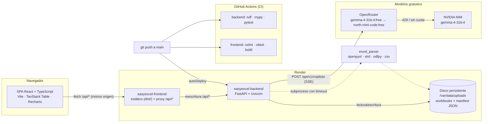

# Arquitectura de EasyExcel Panel

Visión general del sistema en producción y de sus límites de seguridad. Las
decisiones que hay detrás de cada elección están en los ADR de [`docs/adr/`](adr/).

## Diagrama



## Recorrido de una petición

1. El navegador llama a `/api/...` en su propio origen; el proxy del sitio
   estático de Render reescribe esas rutas al backend (`render.yaml`), así que
   en producción no hay CORS cruzado.
2. FastAPI valida la entrada con Pydantic y despacha por routers:
   `workbooks` (carga, listado, detalle, filas, export, demo, borrado),
   `copiloto` (SSE) y `health`.
3. Los Excel viven en el disco persistente (`/var/data/uploads`): cada libro
   es un `.xlsx` + un `manifest.json` con su metadato (ADR-0002). Las subidas
   caducan a las 2 h y se purgan en cada operación (ADR-0004).
4. El parseo ocurre en un subproceso con timeout y límites (10 MB, 50 hojas,
   200 columnas, 100.000 filas) — nunca en el hilo de la petición (ADR-0001).
5. El copiloto serializa un contexto acotado (KPIs, alertas, conteos y una
   muestra de filas), lo manda por SSE a la cadena de modelos gratuitos y
   escribe los deltas en el cliente; 20 consultas/día por IP (ADR-0006).

## Mapa de módulos

```
backend/app/
  main.py            create_app(): CORS, rutas, lifespan
  api/routes/        workbooks · copiloto · health (esquemas Pydantic aquí)
  core/config.py     Settings (env EASYEXCEL_*) + límites
  core/storage.py    FS + manifest, purga TTL, validación de path
  core/demo.py       generador del dataset de muestra (semilla fija)
  domain/excel_parser.py  parseo multi-formato en subproceso con timeout
  ai/assistant.py    cadena de proveedores, rate limit por IP, caché

frontend/src/
  api.ts             cliente fetch/SSE tipado
  copilotRender.ts   markdown del copiloto con escape de HTML (anti-XSS)
  edit.ts            motor de edición de hojas (puro)
  session.ts         sesión local por visitante (sessionStorage)
  insights.ts        inferencia de KPIs/alertas desde cualquier hoja
```

## Límites de seguridad vigentes

| Control | Valor | Dónde |
|---|---|---|
| Tamaño de upload | 10 MB, leídos en bloques de 1 MB (413 al primer bloque desbordado) | `api/routes/workbooks.py` |
| Estructura | 50 hojas · 200 columnas · 100.000 filas · 2.000.000 celdas de export | `core/config.py` |
| Parseo | subproceso con timeout (SIGALRM en Unix, sin timeout en Windows) | `domain/excel_parser.py` |
| Caducidad de subidas | 2 h (`EASYEXCEL_UPLOAD_TTL_HOURS`) | `core/storage.py` (ADR-0004) |
| Copiloto | 20 consultas/día por IP real (última IP de `X-Forwarded-For`), caché de 200, `max_tokens` 1500, timeout 90 s | `ai/assistant.py`, `api/routes/copiloto.py` (ADR-0006) |
| HTML del copiloto | escape de `&`, `<`, `>` antes del markdown, con tests de DOM | `frontend/src/copilotRender.ts` |
| CORS | proxy mismo origen en prod; allowlist explícita (`EASYEXCEL_CORS_ORIGINS`) | `main.py`, `render.yaml` |
| Autenticación | **sin implementar** (Fase 8): la API es anónima hoy | — |

## Despliegue

- **Backend** `easyexcel-backend.onrender.com`: Python 3.14, `uvicorn app.main:app`,
  health check en `/health`, disco de 1 GB montado en `/var/data`, despliegue
  automático al hacer push a `main`.
- **Frontend** `easyexcel-frontend.onrender.com` (dominio propio
  `easyexcel.kavanasystems.com`): build estático de Vite con proxy `/api/*`.
- **CI** `.github/workflows/ci.yml`: dos jobs en paralelo (backend: ruff + mypy +
  pytest; frontend: oxlint + vitest + build) en cada push y PR.
- Configuración como código: [`render.yaml`](../render.yaml).

## Deuda conocida

- Sin autenticación ni multiusuario (Fase 8); no exponer datos reales.
- Almacenamiento FS tras interfaz `Storage`: migrar a S3-compatible cuando
  haya que escalar en horizontal (ADR-0001).
- El frontend se sirve como SPA única sin code-splitting (bundle > 500 kB).
